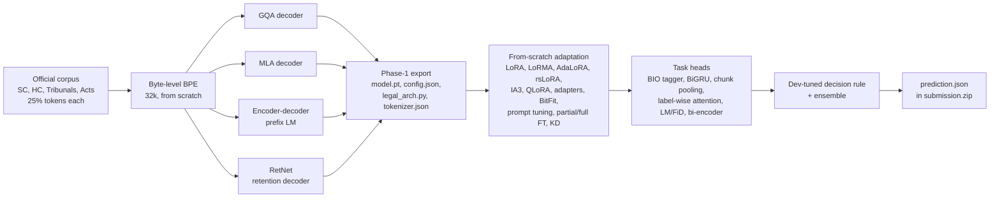
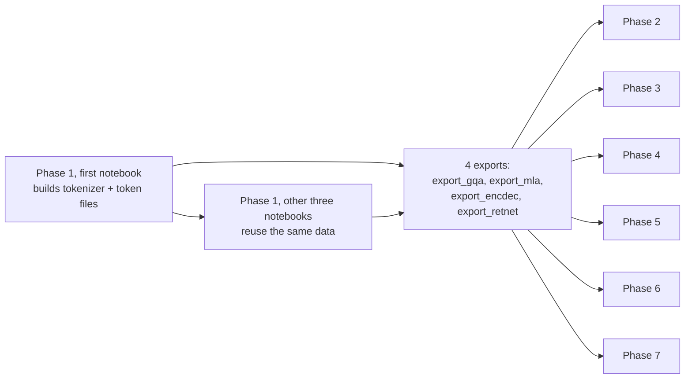

# CS781 Capstone: In-House Legal Intelligence System

A self-hosted legal NLP stack built **entirely from scratch** for the CS781 (IIT Kanpur, 2026) capstone. Four ~125M-parameter legal language models are pre-trained on the official Indian legal corpus. Every downstream task (named entity recognition, rhetorical roles, judgment prediction, statute identification, summarization, prior-case retrieval) is built on top of them with adaptation methods that are also written from scratch: no `peft`, no `bitsandbytes`, no pretrained weights and no external APIs.

| | |
|---|---|
| **Author** | Soham Girish Panchal (231014) |
| **Codabench username** | `s_231014` |
| **Data** | [`Exploration-Lab/CS-781-Capstone`](https://huggingface.co/datasets/Exploration-Lab/CS-781-Capstone) (official data only) |
| **Compute** | Kaggle, 2 × NVIDIA T4 (16 GB), fp16 |
| **Report** | [`report/CS781-CP-Soham-Panchal-231014-report.pdf`](report/CS781-CP-Soham-Panchal-231014-report.pdf) |

Every notebook in `code/` is the **executed Kaggle version, with its cell outputs** (training logs, dev scores, plots), so the numbers below can be traced back to the run that produced them.

---

## Contents

1. [Results at a glance](#1-results-at-a-glance)
2. [Repository layout](#2-repository-layout)
3. [System architecture](#3-system-architecture)
4. [How to run the notebooks](#4-how-to-run-the-notebooks)
5. [Phase 1: Legal language model pre-training](#5-phase-1-legal-language-model-pre-training)
6. [Shared transfer protocol (Phases 2-7)](#6-shared-transfer-protocol-phases-27)
7. [Phase 2: Legal NER](#7-phase-2-legal-named-entity-recognition-l-ner)
8. [Phase 3: Rhetorical role prediction](#8-phase-3-rhetorical-role-prediction-rr)
9. [Phase 4: Court judgment prediction](#9-phase-4-court-judgment-prediction-cjpe)
10. [Phase 5: Legal statute identification](#10-phase-5-legal-statute-identification-lsi)
11. [Phase 6: Abstractive summarization](#11-phase-6-abstractive-summarization)
12. [Phase 7: Prior case retrieval](#12-phase-7-prior-case-retrieval-pcr)
13. [Codabench submissions in this repository](#13-codabench-submissions-in-this-repository)
14. [Key findings](#14-key-findings)
15. [Limitations and future work](#15-limitations-and-future-work)
16. [Compliance with the competition rules](#16-compliance-with-the-competition-rules)
17. [References](#17-references)

---

## 1. Results at a glance

Best valid Codabench score per phase (public leaderboard, recorded 9 November 2026).

| Phase | Task | Primary metric | Best score | Best submission | Rank | Valid subs |
|---|---|---|---|---|---|---|
| 1 | Legal LM pre-training | BERTScore-F1 | **0.8317** | MLA decoder, equal data mix | 64 / 142 | 6 |
| 2 | Legal NER | Strict macro-F1 | **0.3720** | LoRA r=16 on GQA | 112 / 133 | 6 |
| 3 | Rhetorical role prediction | Macro-F1 | **0.5075** | 5-run ensemble + dev-tuned class biases | 55 / 132 | 8 |
| 4 | Court judgment prediction | Macro-F1 | **0.6934** | Full-FT + LoRMA (GQA) ensemble, threshold 0.335 | 81 / 132 | 8 |
| 5 | Legal statute identification | Macro-F1 | **0.3635** | Greedy ensemble (full, partial, LoRMA-tail) | 81 / 133 | 8 |
| 6 | Abstractive summarization | BERTScore-F1 | **0.8350** | MBR ensemble (LoRA, KD, Pfeiffer) | 83 / 131 | 10 |
| 7 | Prior case retrieval | Micro-F1@7 | **0.4076** | Ensemble of 7 dense runs + BM25 + temporal penalty | 59 / 133 | 9 |

55 scored submissions in total (63 uploads; 7 failed or were cancelled server-side and 1 never left the queue).

---

## 2. Repository layout

```
CS781-Capstone-Project/
├── README.md
├── .gitignore
├── code/                                  # executed Kaggle notebooks (with outputs), one folder per phase
│   ├── phase1/
│   │   ├── Phase1_Arch1_GQA_RoPE_Decoder.ipynb            # equal data mix (final models)
│   │   ├── Phase1_Arch2_MLA_Decoder.ipynb                 # ← best Phase-1 submission
│   │   ├── Phase1_Arch3_EncoderDecoder_PrefixLM.ipynb
│   │   ├── Phase1_Arch4_RetNet_Retention_Decoder.ipynb
│   │   └── sc_heavy_mix/                                  # first round: same notebooks, Supreme-Court-heavy mix
│   ├── phase2/
│   │   ├── Phase2_Exp1_LoRA_GQA.ipynb                     # ← best Phase-2 submission
│   │   ├── Phase2_Exp2_LoRMA_RetNet.ipynb
│   │   ├── Phase2_Exp3_HoulsbyAdapters_MLA.ipynb
│   │   ├── Phase2_Exp4_KnowledgeDistillation.ipynb
│   │   ├── Phase2_Exp5_PartialFT_GQA.ipynb                # after the deadline (local score only)
│   │   └── Phase2_Exp6_FullFT_EncDec.ipynb                # after the deadline (local score only)
│   ├── phase3/
│   │   ├── Phase3_RR_Train.ipynb                          # one run per METHOD / BACKBONE_ARCH
│   │   ├── Phase3_RR_AllRuns_SentenceOnlyAblation.ipynb   # executed all-runs notebook (context ablation)
│   │   └── Phase3_RR_Ensemble.ipynb
│   ├── phase4/  Phase4_CJPE_AllRuns.ipynb, Phase4_CJPE_Ensemble.ipynb
│   ├── phase5/  Phase5_LSI_AllRuns.ipynb
│   ├── phase6/  Phase6_Summ_AllRuns.ipynb
│   └── phase7/  Phase7_PCR_AllRuns.ipynb
├── submissions/                           # all 55 scored Codabench submissions, as uploaded
│   └── phase1/ … phase7/                  # <codabench-id>_<filename>.zip, prediction.json at the zip root
├── evaluation/                            # official evaluate_phase1.py … evaluate_phase7.py (course material)
├── results/
│   └── phase7/phase7_run.log              # full driver log of the Phase-7 run
└── report/
    └── CS781-CP-Soham-Panchal-231014-report.pdf
```

Each notebook writes its helper modules (`legal_arch.py`, `ner_lib.py`, `rr_lib.py`, `cj_lib.py`, `ls_lib.py`, `sm_lib.py`, `pcr_lib.py` and the matching `*_peft.py`, `*_run.py`, `*_ens.py`) with `%%writefile` cells. **Every notebook is self-contained:** apart from the Phase-1 exports it loads, nothing outside the notebook is needed.

**Not in the repository:** the dataset (downloaded from Hugging Face by the notebooks) and model weights (each `model.pt` is about 500 MB, above GitHub's 100 MB file limit). The weights are reproduced by running the Phase-1 notebooks.

---

## 3. System architecture



One tokenizer and four backbones are shared by every phase. Each later phase adds an adaptation method, a task head, and a decision rule or ensemble tuned on dev data.

---

## 4. How to run the notebooks

### 4.1 One-time Kaggle setup

1. **Hugging Face token.** In Kaggle, open *Add-ons → Secrets* and add a secret named **`HF`** holding your Hugging Face read token. Every notebook reads it (it falls back to the `HF_TOKEN` environment variable, then to anonymous access).
2. **Notebook settings** for every run: *Accelerator* = **GPU T4 × 2**, *Internet* = **On**.
3. Kaggle's default Python image already has everything used (PyTorch, `tokenizers`, `huggingface_hub`, NumPy, matplotlib). The notebooks `pip install` the few extras they need (`ijson` for streaming the Phase-1 corpus; `bert-score`/`rouge-score` only for local evaluation).

To run outside Kaggle, install PyTorch with CUDA plus `tokenizers huggingface_hub numpy matplotlib ijson`, set `HF_TOKEN`, and run from the repository folder. Paths fall back from `/kaggle/working` and `/kaggle/input` to the current directory.

### 4.2 Run order

Phases depend on each other only through the **Phase-1 export folders** (`export_<arch>/` = `model.pt`, `config.json`, `legal_arch.py`, `tokenizer.json`).



| Step | Notebook | Kaggle inputs to attach | What to set | Output | Time on 2×T4 |
|---|---|---|---|---|---|
| 1 | Any one `code/phase1/Phase1_Arch*.ipynb` | none | `TRAIN_MIX` in the config cell (equal mix = 0.25 each) | `cs781_phase1_data/` (tokenizer, `train.bin`, `val.bin`, `meta.json`) and `cs781_phase1_<arch>/export_<arch>/` | 2.5–7.1 h |
| 2 | The other three Phase-1 notebooks | the output of step 1 (auto-detected through `meta.json`, so all four share one tokenizer and dataset) | nothing | `export_<arch>/` for each architecture | 2.5–7.1 h each |
| 3 | `code/phase2/Phase2_Exp*.ipynb` | the matching `export_<arch>/` | `BACKBONE_ARCH`, `METHOD` (see §7) | `ner_export_<method>_<arch>/`, `submission.zip` | 1–2 h each |
| 4 | `code/phase3/Phase3_RR_Train.ipynb`, once per run, then `Phase3_RR_Ensemble.ipynb` (CPU) | the four exports; KD and the ensemble also need the earlier `rr_*` run folders | `METHOD`, `BACKBONE_ARCH` | `rr_<method>_<arch>/` | 10–65 min per run |
| 5 | `code/phase4/Phase4_CJPE_AllRuns.ipynb`, then `Phase4_CJPE_Ensemble.ipynb` (CPU) | the four exports | `SMOKE` in the last cell | `cj_<method>_<arch>/`, `submissions/` | ~5 h |
| 6 | `code/phase5/Phase5_LSI_AllRuns.ipynb` | the four exports | `SMOKE` | `ls_<method>_<arch>/`, `submissions/` | ~6 h |
| 7 | `code/phase6/Phase6_Summ_AllRuns.ipynb` | the four exports | `SMOKE` | `sm_<method>_<arch>/`, `submissions/` | ~6.5 h |
| 8 | `code/phase7/Phase7_PCR_AllRuns.ipynb` | the four exports | `SMOKE` | `pcr_<method>_<arch>/`, `submissions/` | ~4 h |

**Attaching the Phase-1 exports.** After a Phase-1 run finishes, either attach its notebook output directly as an input, or upload its `export_<arch>/` folder as a Kaggle dataset (named e.g. `export-gqa`). The loaders search `/kaggle/input/**` for any folder holding a `config.json` whose `"arch"` matches plus a `model.pt`, so the mount path does not matter. You can also set `P1_EXPORT_DIR` to the folder explicitly.

### 4.3 Running a Phase-1 notebook

1. Open the notebook and check the **Configuration** cell (section 3). Every hyper-parameter lives there: `TRAIN_MIX`, `TOTAL_TRAIN_TOKENS` (200M), `VOCAB_SIZE` (32k), `MICRO_BATCH`, `LR`, `MAX_HOURS`, and the decoding defaults.
2. *Save Version → Save & Run All*. The notebook will:
   1. prepare the data (or reuse it),
   2. run a sanity test on a tiny copy of the model (causality, bidirectionality, cached decoding equal to the full forward pass),
   3. train with a checkpoint every 250 steps,
   4. plot the curves,
   5. compare the 25/50/75/100% snapshots,
   6. run a 5-setting decoding sweep,
   7. write `submission.zip`,
   8. export `export_<arch>/`.
3. **If Kaggle's session limit hits** (`MAX_HOURS = 11`), the last checkpoint is saved. Attach that output as an input and run the notebook again: `RESUME = True` continues from `ckpt_last.pt`.

### 4.4 Running a Phase-2 notebook

Each Phase-2 notebook is one experiment. The configuration cell (section 3) chooses `BACKBONE_ARCH` and `METHOD`. The partial and full fine-tuning variants override them on one line of that cell (`METHOD = "full"`, plus `BACKBONE_ARCH = "encdec"` for Exp 6). The notebook prints an **oracle F1** before training (gold spans → BIO → spans; expect ≈ 0.987). It stops if the oracle F1 is below 0.5, because that means the offsets are broken. It then trains, prints a per-label error breakdown, and writes `submission.zip` and `ner_export_<method>_<arch>/`.

For **Exp 4 (distillation)**, attach the teacher's `ner_export_*` folder and the student's Phase-1 export, and set `TEACHER_DIR` explicitly. The submitted run used the LoRA-GQA teacher and a RetNet student (`STUDENT_ARCH = "retnet"`). The notebook checks by hash that teacher and student share a tokenizer.

### 4.5 Running the all-runs notebooks (Phases 4–7)

Each of these notebooks runs every experiment of its phase. Each run is a separate process, with one queue per T4. Then come knowledge distillation (which needs the earlier runs as teachers), any ablation, and finally the ensemble.

1. Attach the four exports and set the accelerator to **GPU T4 × 2**.
2. Run once with **`SMOKE = True`** in the last (driver) cell. This is a 10–25 min check on a few documents.
3. Set `SMOKE = False`, then *Save Version → Save & Run All*.
4. When it finishes, every zip is collected in `/kaggle/working/submissions/`. Each run folder holds `results.json` (config, trainable parameters, dev scores, timing) plus the dev/test probabilities or predictions that the ensemble and distillation steps read. Per-run logs are in `/kaggle/working/logs/`.

The run schedule (which method on which backbone, on which GPU) is the `QUEUES` dictionary in the driver cell. Edit it to add or drop runs.

### 4.6 Local evaluation

The official scorers are in [`evaluation/`](evaluation/). The notebooks write dev predictions in the same format, and Phases 6 and 7 run the official script on dev at the end. Example for Phase 3:

```bash
python evaluation/evaluate_phase3.py --truth-cl dev_truth_CL.json --truth-it dev_truth_IT.json \
       --prediction dev_prediction.json --labels labels.json
```

---

## 5. Phase 1: Legal language model pre-training

**Task.** Given a 512-word legal prompt, generate a 128-word continuation. **Metric:** BERTScore-F1 (secondary: ROUGE-L, BLEU-4).

### 5.1 Data and tokenizer

- **Sources:**

  | Source | Size | Median document length |
  |---|---|---|
  | Supreme Court | 1.32 GB | 3,752 words |
  | High Courts | 10.67 GB | 258 words (mostly short orders) |
  | Tribunals | 6.48 GB | |
  | Acts | 0.73 GB | |

  Raw proportions would be dominated by High Court text.
- **Mix.**
  - About 50M tokens are taken from each source: 202.6M training tokens, plus 4.37M validation tokens from a 2% **document-level** split.
  - The first round used a Supreme-Court-heavy mix (0.50 / 0.30 / 0.10 / 0.10); those notebooks are in [`code/phase1/sc_heavy_mix/`](code/phase1/sc_heavy_mix/).
  - All four models were then re-trained on the equal mix, so every backbone shares one tokenizer, one training stream and one validation set.
- **Tokenizer:**
  - 32k **byte-level BPE**, trained from scratch on a 200M-character sample with no lowercasing.
  - It is lossless and returns character offsets, which Phase 2 relies on.
  - Special tokens: `<|endoftext|>`=0, `<|pad|>`=1, `<|bos|>`=2.
  - Runs of whitespace are collapsed, and tokens are stored as `uint16`.

### 5.2 Architectures

All four share d=768, 12 heads, a SwiGLU FFN (2,048), pre-RMSNorm, tied embeddings and the 32k vocabulary. They differ **only in the sequence mixer**.

| Notebook | Architecture | Layers | Params | Key design |
|---|---|---|---|---|
| `Phase1_Arch1_GQA_RoPE_Decoder` | LLaMA-style decoder, grouped-query attention | 16 | 125.3M | 12 query heads share 4 KV heads; RoPE; SDPA kernel |
| `Phase1_Arch2_MLA_Decoder` | Multi-head latent attention (DeepSeek-V2 style) | 16 | 125.7M | K and V rebuilt from one 192-d latent; decoupled 16-d RoPE key; KV cache of 208 numbers per token (GQA: 512) |
| `Phase1_Arch3_EncoderDecoder_PrefixLM` | T5-style encoder-decoder | 6+6 | 123.7M | Bidirectional encoder; causal decoder with cross-attention; prefix-LM objective on a 1,280-token window split at a random point |
| `Phase1_Arch4_RetNet_Retention_Decoder` | Multi-scale retention (RetNet) | 13 | 124.3M | S_n = γ_h S_{n-1} + k_nᵀ v_n with γ_h = 1 − 2^(−5−h); chunkwise-parallel training (chunk 256, fp32); constant-size recurrent state for generation |

Each model asserts 50M ≤ params ≤ 300M.

### 5.3 Training and generation

- **Objective and schedule.**
  - Next-token cross-entropy on 2,049-token blocks, one pass over 200M tokens (3,050 steps of 65.6k tokens).
  - AdamW (β = 0.9, 0.95; weight decay 0.1); peak LR 5e-4; 150 warm-up steps; cosine decay to 10%.
  - fp16, gradient clipping at 1.0.
- **Comparison metric.** Models are compared on the *continuation loss*: the NLL of 512 tokens given a 768-token prefix of held-out documents. The encoder-decoder only trains on its decoder half, so plain perplexities would not be comparable.
- **Generation.**
  - Uses a KV cache (or the recurrent state for RetNet), masks special tokens, and applies a repetition penalty to generated tokens and nucleus sampling.
  - It runs until every sequence has at least 128 words, then cuts each to exactly 128.
  - The decoding settings were chosen from a 5-setting sweep on 48 held-out prompts.

### 5.4 Results

| Architecture | Val loss (ppl) | Local BERTScore | Train time | Codabench |
|---|---|---|---|---|
| GQA | **2.724** (15.2) | 0.8485 | 5.9 h | 0.8307 (SC-heavy mix) |
| MLA | 2.810 (16.6) | **0.8498** | 5.5 h | **0.8317** |
| Enc-dec | 3.163 (23.6) | 0.8175 | 2.5 h | 0.8148 |
| RetNet | 3.090 (22.0) | 0.8486 | 7.1 h | 0.8286 (SC-heavy mix) |

GQA has the lowest loss, but MLA scores best. BERTScore barely separates the decoders, but it penalises short or looping outputs, which MLA avoided. Decoding mattered more than architecture: GQA scores 0.830 greedy versus 0.849 with repetition penalty 1.15.

---

## 6. Shared transfer protocol (Phases 2-7)

Every task model starts from a Phase-1 export:

1. The LM head is dropped. Except in Phase 6, the encoder-decoder's decoder is dropped too.
2. An adaptation method is applied.
3. A task head is trained.

**All four backbones are used in every phase.**

| Method | Formulation / notes |
|---|---|
| LoRA | W = W0 + (α/r)·BA |
| **LoRMA+** (compulsory) | W = (I + (α/r)·BA)·W0, computed as h0 = W0x, h = h0 + (α/r)·B(A·h0). B = 0 at init, so training starts from the Phase-1 model |
| rsLoRA | LoRA with α/√r scaling |
| AdaLoRA | SVD-form update with importance-based rank pruning (e.g. r 12 → 6) |
| IA³ | Learned rescaling of keys, values and FFN activations |
| QLoRA | Custom block-wise NF4 quantisation of the frozen backbone (RetNet: 497 MB → 56 MB), plus LoRA |
| Houlsby / Pfeiffer adapters | Bottleneck adapters, two per block / one per block |
| BitFit | Biases only |
| Prompt tuning | 20 learned soft-prompt vectors |
| Partial / full fine-tuning | Top 6 blocks / all weights |
| **Knowledge distillation** | The student is a Phase-1 model with every other layer kept (6–8 layers), initialised from its weights and fully fine-tuned on a·CE + (1−a)·T²·KL(p_teacher ‖ p_student). From Phase 3 on, the teacher is the mean prediction of the strongest earlier runs |

Merged LoRA/LoRMA weights reproduce the unmerged logits (max. difference 1.8e-5 and 4.3e-5).

**Common training protocol:**

- AdamW with warm-up then decay, gradient clipping at 1.0, weight decay 0.01, and a higher LR for the new head.
- The best dev checkpoint is kept.
- From Phase 4 on, every run gets a fixed time budget (75 / 75 / 60 / 40 minutes in Phases 4 / 5 / 6 / 7), so methods are compared at equal compute.

---

## 7. Phase 2: Legal Named Entity Recognition (L-NER)

**Task.** Predict `[start, end, label]` character spans for 12 entity types: APP, RESP, A.COUNSEL, R.COUNSEL, JUDGE, WIT, AUTH, COURT, STAT, PREC, DATE and CASENO. **Metric:** strict macro-F1.

**Data.** 70 training documents (8,393 entities) and 35 test documents. There is no dev split, so 10 documents (15%, split at document level) are held out.

**Method.**

- **Offset-preserving tokenisation.** Whitespace normalisation keeps a map from each normalised character back to its original position. Each BPE token inside an entity gets a B- or I- tag (25 tags). Predicted runs are mapped back to original character offsets.
- **Oracle check.** Gold spans are encoded to BIO, decoded back and scored before training: **oracle macro-F1 = 0.987**.
- **Windows.** 384-token windows (512 for the encoder) with stride 192. At inference, overlapping windows' log-probabilities are averaged with weights that trust the window centres most.
- **Decoder trick.** Causal decoders read each window twice (`[w, w]`), and the head reads the second copy, so every token sees the whole window.
- **Head and decoding.** A linear head is trained with cross-entropy. Later runs down-weight the `O` tag to 0.5. Decoding takes the arg-max tag per token and merges BIO runs into spans.

| Notebook | Method | Backbone | Local F1 | Codabench |
|---|---|---|---|---|
| Exp1 | LoRA r=16, α=32 (first run) | GQA | n/a | **0.3720** |
| Exp1 | LoRA r=16, α=32 (re-run) | GQA | 0.317 | 0.3632 |
| Exp3 | Houlsby adapters m=64 | MLA | 0.295 | 0.3381 |
| Exp2 | LoRMA+ r=16 (2 runs) | RetNet | 0.250 | 0.3035 / 0.2906 |
| Exp4 | KD: LoRA-GQA teacher → 6-layer RetNet student (a=0.5, T=2) | RetNet | 0.246 | 0.2912 |
| Exp5 | Partial FT, top 6 blocks (after the deadline) | GQA | **0.410** | n/a |
| Exp6 | Full FT of the encoder (after the deadline) | Enc-dec | 0.212 | n/a |

Only training more of the backbone helped: partial fine-tuning cut boundary errors from 594 to 241. WIT and APP fail because the same name can be a party, counsel or witness depending on context outside the window.

---

## 8. Phase 3: Rhetorical Role Prediction (RR)

**Task.** One of 13 rhetorical roles per sentence, in the CL and IT domains. **Metric:** macro-F1.

**Notebooks.**

- `Phase3_RR_Train.ipynb` trains one run; set `METHOD` and `BACKBONE_ARCH`.
- `Phase3_RR_AllRuns_SentenceOnlyAblation.ipynb` is the executed all-runs notebook. It writes the same `rr_lib.py` / `rr_peft.py` / `rr_run.py` / `rr_ens.py` and runs the sentence-only context ablation. Version 1 of this notebook ran the six techniques and the ensemble with the same files.
- `Phase3_RR_Ensemble.ipynb` greedily selects runs for the ensemble (Caruana et al., 2004) and tunes per-class biases, with an honest 2-fold check. It runs on CPU in about a minute.

**Model.**

1. Sentences are packed into chunks of at most 320 tokens and encoded by the backbone.
2. Each sentence is pooled (mean plus attention).
3. A CL/IT domain embedding and relative-position features are added.
4. A 2-layer BiGRU runs over the whole document.
5. A linear layer predicts the 13 roles.

Training uses class-weighted cross-entropy (inverse frequency^0.5), label smoothing 0.05, and early stopping on dev macro-F1. The backbone stays frozen in every PEFT run.

| Variant | Backbone | Dev | Codabench |
|---|---|---|---|
| Ensemble (5 runs) + class biases | mixed | **0.509** | **0.5075** |
| AdaLoRA r 12→6 | RetNet | 0.485 | 0.5073 |
| KD: ensemble teacher → 8-layer student | GQA | 0.472 | 0.5071 |
| LoRMA+ r=16 | GQA | 0.494 | 0.4992 |
| IA³ | MLA | 0.488 | 0.4893 |
| rsLoRA r=64 | RetNet | 0.450 | 0.4822 |
| LoRA r=16 | Enc-dec encoder | 0.378 | 0.4071 |
| Ablation: sentence only (no neighbours, no BiGRU) | GQA | 0.348 | 0.3804 |

Context is decisive: without it, argument and precedent sentences collapse into RatioOfTheDecision. The distilled 8-layer student (55% of the parameters, 2.5× faster) beat its best single teacher on test.

---

## 9. Phase 4: Court Judgment Prediction (CJPE)

**Task.** Predict whether the appeal is accepted (1) or rejected (0). **Metric:** macro-F1.

**Model.**

- The court's reasoning sits at the end of a judgment, so each document is cut to its **last 4 × 512 tokens**.
- Each chunk is pooled and given a position-from-end embedding.
- The chunks are combined by attention pooling plus the final-chunk vector into 2 logits.
- Training samples 2–4 tail chunks and 10k documents per epoch, with class-weighted cross-entropy.
- Train is 58.6% class 0, while dev and test are balanced. The threshold on p(1) is therefore tuned on dev, and kept only if a 2-fold check on dev confirms it.

| GPU 0 | GPU 1 |
|---|---|
| Full fine-tuning (GQA) | Partial FT, top 6 layers (RetNet) |
| **LoRMA** (GQA) | Houlsby adapters (Enc-dec) |
| BitFit (MLA) | AdaLoRA (RetNet) |

These six runs are followed by KD (teacher = mean of the six runs; student = 8-layer GQA) and the ensemble notebook.

| Run | Trainable params | Dev (2-fold honest) | Codabench |
|---|---|---|---|
| Ensemble: full + LoRMA (GQA), threshold 0.335 | n/a | **0.702** | **0.6934** |
| Full FT (GQA) | 126.3M | 0.693 | 0.6796 |
| LoRMA r=16 (GQA) | 4.60M | 0.692 | 0.6721 |
| Partial FT (RetNet) | 47.1M | 0.668 | 0.6611 |
| KD → 8-layer GQA | 76.0M | 0.661 | 0.6533 |
| AdaLoRA (RetNet) | 3.58M | 0.646 | 0.6411 |
| BitFit (MLA) | 1.22M | 0.650 | 0.6249 |
| Houlsby (Enc-dec) | 2.26M | 0.569 | 0.5797 |

LoRMA matched full fine-tuning with 3.6% of the trainable parameters. Threshold tuning was the largest single gain: the adapter model goes from 0.336 at 0.5 to 0.569.

---

## 10. Phase 5: Legal Statute Identification (LSI)

**Task.** Predict the set of applicable statutes (100 labels, 3.70 per document on average). **Metric:** macro-F1.

**Model.**

- The model reads the first chunks plus the final chunk (up to 4 × 512 tokens).
- Two heads are summed: **label-wise attention** (each statute has its own query vector attending over all tokens) and a global document vector.
- **Loss:** BCE with a per-statute positive weight of clip(√(neg/pos), 1, 15).
- **Decision rule:** a repeated 2-fold check on dev picks between a fixed 0.5, one global threshold, and per-statute thresholds shrunk towards the global one. Per-statute thresholds won for every run. Every document gets at least one statute.

| Variant | Dev | Codabench |
|---|---|---|
| Greedy ensemble (full, partial, LoRMA-tail) | **0.363** | **0.3635** |
| Full FT (GQA) | 0.354 | 0.3588 |
| All-run ensemble | 0.351 | 0.3533 |
| KD → 8-layer GQA | 0.348 | 0.3472 |
| LoRMA (GQA), tail chunks only (ablation) | 0.345 | 0.3461 |
| BitFit (MLA) | 0.331 | 0.3304 |
| AdaLoRA (RetNet) | 0.296 | 0.2994 |
| Houlsby (Enc-dec) | 0.247 | 0.2468 |

The models over-predict (5.1–7.1 statutes per document vs 3.9 gold), so subset accuracy stays around 0.03.

---

## 11. Phase 6: Abstractive Summarization

**Task.** Summarise a judgment. **Metric:** BERTScore-F1. 300 documents are held out by ID hash (120 of them are scored).

**Model.**

- **Decoders** continue `[head … tail] + " Summary of the judgment:"`. The document part is 1,152 tokens (the first 960 plus the last 192), and the loss is on the summary tokens only (up to 880).
- **Encoder-decoder** uses Fusion-in-Decoder: up to four 1,024-token chunks are encoded separately, and the decoder attends to all 4,096 encoder states.
- **Generation** is greedy with n-gram blocking. A length model, ln(summary words) = 0.610·ln(document words) + 1.550, sets a per-document length window. Three decoding settings are compared on the held-out documents.
- **Ensemble:** minimum-Bayes-risk consensus. For each document, it keeps the run summary with the highest mean ROUGE-1 against the other runs' summaries.

| Variant | Held-out | Codabench |
|---|---|---|
| MBR ensemble (LoRA, KD, Pfeiffer) | **0.837** | **0.8350** |
| LoRA r=32 (GQA) | 0.836 | 0.8345 |
| KD: LoRA-GQA → 8-layer GQA | 0.835 | 0.8339 |
| Pfeiffer adapter (MLA) | 0.833 | 0.8310 |
| MBR ensemble of all 7 runs | 0.833 | 0.8304 |
| AdaLoRA (MLA) | 0.830 | 0.8284 |
| QLoRA NF4 (RetNet) | 0.828 | 0.8244 |
| Houlsby (Enc-dec, FiD) | 0.822 | 0.8182 |
| LoRMA (Enc-dec, FiD) | 0.821 | 0.8180 |
| LoRMA (Enc-dec), one chunk (ablation) | 0.821 | 0.8163 |

LoRA decoders beat the encoder-decoder by about 0.015 BERTScore, despite reading 3.5× less text. A lead-N baseline (the first N words of the judgment) already reaches 0.828.

---

## 12. Phase 7: Prior Case Retrieval (PCR)

**Task.** Return the 7 most relevant prior cases for each query. **Metric:** micro-F1@7.

**Method.**

1. `pcr_prep.py` runs on CPU once. It parses the data and builds a **from-scratch BM25**, tuned on dev: unigrams plus bigrams, k1 = 1.5, b = 0.9, log query weights. This alone gives dev F1@7 = 0.360.
2. **Bi-encoder on the Phase-1 backbone.**
   - 16 evenly spaced 512-token chunks are stored per document, and 8 are read at inference.
   - Each chunk becomes a 256-d unit vector.
   - Relevance is chunk max-sim (ColBERT-style) or the cosine of the mean vectors.
   - Training uses InfoNCE with BM25 hard negatives and in-batch negatives.
3. **Hybrid score:** w·z(dense) + (1−w)·z(BM25) − λ·[candidate dated after the query], with w = 0.75 and λ = 2 tuned on dev. Every run writes `*_hybrid.zip` and `*_dense.zip`.

| Variant | Dev | Codabench |
|---|---|---|
| Ensemble of 7 runs | 0.406 | **0.4076** |
| IA³ (MLA) | 0.406 | 0.4058 |
| Greedy ensemble (partial-MLA, full-GQA) | **0.421** | 0.4052 |
| Partial FT (MLA) | 0.409 | 0.4034 |
| LoRMA (Enc-dec), random negatives | 0.397 | 0.4028 |
| QLoRA NF4 (RetNet) | 0.395 | 0.4028 |
| KD: 3 runs → 8-layer GQA | 0.403 | 0.4011 |
| Full FT (GQA) | 0.401 | 0.3999 |
| Prompt tuning, 20 tokens (GQA) | 0.399 | 0.3987 |
| BM25 + temporal penalty only (local) | 0.399 | n/a |

Lexical matching dominates: every dense model on its own stayed around 0.30, below BM25. The full driver log is in [`results/phase7/phase7_run.log`](results/phase7/phase7_run.log).

---

## 13. Codabench submissions in this repository

[`submissions/`](submissions/) holds **all 55 scored Codabench submissions**, downloaded from Codabench. The files are named `<Codabench submission ID>_<uploaded file name>`. Each zip holds a single `prediction.json` at the zip root, exactly as it was uploaded. ★ marks the submission on the public leaderboard. Eight more uploads failed, were cancelled on the server or never left the queue. They have no score and are not included.


**Phase 1** (BERTScore-F1)

| File | Run | Score | Secondary |
|---|---|---|---|
| [`956794_submission.zip`](submissions/phase1/956794_submission.zip) | MLA decoder, equal mix ★ | **0.8317** | ROUGE-L 0.1901 / BLEU-4 0.0411 |
| [`956137_submission.zip`](submissions/phase1/956137_submission.zip) | RetNet, SC-heavy mix | 0.8286 | ROUGE-L 0.1836 / BLEU-4 0.0394 |
| [`956127_submission.zip`](submissions/phase1/956127_submission.zip) | Encoder-decoder, equal mix | 0.8148 | ROUGE-L 0.1699 / BLEU-4 0.0191 |
| [`955537_submission.zip`](submissions/phase1/955537_submission.zip) | Encoder-decoder, SC-heavy mix | 0.8201 | ROUGE-L 0.1729 / BLEU-4 0.0187 |
| [`955521_submission.zip`](submissions/phase1/955521_submission.zip) | MLA decoder, SC-heavy mix | 0.8307 | ROUGE-L 0.1890 / BLEU-4 0.0468 |
| [`955192_submission.zip`](submissions/phase1/955192_submission.zip) | GQA decoder, SC-heavy mix | 0.8307 | ROUGE-L 0.1894 / BLEU-4 0.0471 |

**Phase 2** (Strict macro-F1)

| File | Run | Score | Secondary |
|---|---|---|---|
| [`971883_submission_LoRA_gqa.zip`](submissions/phase2/971883_submission_LoRA_gqa.zip) | LoRA r=16, GQA ★ | **0.3720** | P 0.3543 / R 0.3993 |
| [`975769_submission_LoRA_gqa_2.zip`](submissions/phase2/975769_submission_LoRA_gqa_2.zip) | LoRA r=16, GQA (re-run) | 0.3632 | P 0.3418 / R 0.3952 |
| [`975627_submission_houlsby_mha.zip`](submissions/phase2/975627_submission_houlsby_mha.zip) | Houlsby adapters, MLA | 0.3381 | P 0.3075 / R 0.3812 |
| [`972130_submission_LoRMA_retnet.zip`](submissions/phase2/972130_submission_LoRMA_retnet.zip) | LoRMA+, RetNet | 0.3035 | P 0.2684 / R 0.3588 |
| [`977321_submission_KD_gqaLora.zip`](submissions/phase2/977321_submission_KD_gqaLora.zip) | KD: LoRA-GQA → 6-layer RetNet | 0.2912 | P 0.2794 / R 0.3153 |
| [`976813_submission_LoRMA_retnet_2.zip`](submissions/phase2/976813_submission_LoRMA_retnet_2.zip) | LoRMA+, RetNet (second run) | 0.2906 | P 0.2640 / R 0.3311 |

**Phase 3** (Macro-F1)

| File | Run | Score | Secondary |
|---|---|---|---|
| [`983187_rr_ensemble.zip`](submissions/phase3/983187_rr_ensemble.zip) | Ensemble (5 runs) + class biases ★ | **0.5075** | P 0.6217 / R 0.5093 |
| [`983200_rr_adalora_retnet.zip`](submissions/phase3/983200_rr_adalora_retnet.zip) | AdaLoRA, RetNet | 0.5073 | P 0.5752 / R 0.5210 |
| [`985040_rr_kd_gqa_v2.zip`](submissions/phase3/985040_rr_kd_gqa_v2.zip) | KD → 8-layer GQA | 0.5071 | P 0.5184 / R 0.5094 |
| [`983196_rr_lorma_gqa.zip`](submissions/phase3/983196_rr_lorma_gqa.zip) | LoRMA+, GQA | 0.4992 | P 0.5690 / R 0.5102 |
| [`983198_rr_ia3_mla.zip`](submissions/phase3/983198_rr_ia3_mla.zip) | IA³, MLA | 0.4893 | P 0.5550 / R 0.4998 |
| [`985041_rr_rslora_retnet_v2.zip`](submissions/phase3/985041_rr_rslora_retnet_v2.zip) | rsLoRA, RetNet | 0.4822 | P 0.5958 / R 0.4716 |
| [`984799_rr_lora_encdec.zip`](submissions/phase3/984799_rr_lora_encdec.zip) | LoRA, Enc-dec encoder | 0.4071 | P 0.3957 / R 0.4438 |
| [`991396_rr_lorma_gqa_sentonly.zip`](submissions/phase3/991396_rr_lorma_gqa_sentonly.zip) | LoRMA+, GQA, sentence-only ablation | 0.3804 | P 0.4298 / R 0.3970 |

**Phase 4** (Macro-F1)

| File | Run | Score | Secondary |
|---|---|---|---|
| [`1001209_ensemble_greedy.zip`](submissions/phase4/1001209_ensemble_greedy.zip) | Ensemble full + LoRMA (GQA), thr 0.335 ★ | **0.6934** | P 0.7020 / R 0.6772 |
| [`1001186_cj_full_gqa.zip`](submissions/phase4/1001186_cj_full_gqa.zip) | Full FT, GQA | 0.6796 | P 0.6875 / R 0.6640 |
| [`1001188_cj_lorma_gqa.zip`](submissions/phase4/1001188_cj_lorma_gqa.zip) | LoRMA, GQA | 0.6721 | P 0.6874 / R 0.6378 |
| [`1001190_cj_partial_retnet.zip`](submissions/phase4/1001190_cj_partial_retnet.zip) | Partial FT, RetNet | 0.6611 | P 0.6586 / R 0.6759 |
| [`1001187_cj_kd_gqa.zip`](submissions/phase4/1001187_cj_kd_gqa.zip) | KD → 8-layer GQA | 0.6533 | P 0.6715 / R 0.6089 |
| [`1001177_cj_adalora_retnet.zip`](submissions/phase4/1001177_cj_adalora_retnet.zip) | AdaLoRA, RetNet | 0.6411 | P 0.6746 / R 0.5604 |
| [`1001184_cj_bitfit_mla.zip`](submissions/phase4/1001184_cj_bitfit_mla.zip) | BitFit, MLA | 0.6249 | P 0.6313 / R 0.6089 |
| [`1001178_cj_adapter_encdec.zip`](submissions/phase4/1001178_cj_adapter_encdec.zip) | Houlsby adapters, Enc-dec | 0.5797 | P 0.5929 / R 0.5276 |

**Phase 5** (Macro-F1)

| File | Run | Score | Secondary |
|---|---|---|---|
| [`1013078_ensemble_greedy_1.zip`](submissions/phase5/1013078_ensemble_greedy_1.zip) | Greedy ensemble (full, partial, LoRMA-tail) ★ | **0.3635** | micro-F1 0.4594 / subset acc 0.0307 |
| [`1013064_ls_full_gqa.zip`](submissions/phase5/1013064_ls_full_gqa.zip) | Full FT, GQA | 0.3588 | micro-F1 0.4502 / subset acc 0.0287 |
| [`1013080_ensemble_all.zip`](submissions/phase5/1013080_ensemble_all.zip) | All-run ensemble | 0.3533 | micro-F1 0.4522 / subset acc 0.0273 |
| [`1013063_ls_kd_gqa_1.zip`](submissions/phase5/1013063_ls_kd_gqa_1.zip) | KD → 8-layer GQA | 0.3472 | micro-F1 0.4416 / subset acc 0.0230 |
| [`1013061_ls_lorma_gqa_tail.zip`](submissions/phase5/1013061_ls_lorma_gqa_tail.zip) | LoRMA, GQA, tail chunks only | 0.3461 | micro-F1 0.4384 / subset acc 0.0238 |
| [`1013070_ls_bitfit_mla.zip`](submissions/phase5/1013070_ls_bitfit_mla.zip) | BitFit, MLA | 0.3304 | micro-F1 0.4292 / subset acc 0.0198 |
| [`1013076_ls_adalora_retnet.zip`](submissions/phase5/1013076_ls_adalora_retnet.zip) | AdaLoRA, RetNet | 0.2994 | micro-F1 0.3940 / subset acc 0.0117 |
| [`1013072_ls_adapter_encdec.zip`](submissions/phase5/1013072_ls_adapter_encdec.zip) | Houlsby adapters, Enc-dec | 0.2468 | micro-F1 0.3387 / subset acc 0.0038 |

**Phase 6** (BERTScore-F1)

| File | Run | Score | Secondary |
|---|---|---|---|
| [`1027136_ensemble_mbr_topk.zip`](submissions/phase6/1027136_ensemble_mbr_topk.zip) | MBR ensemble (LoRA, KD, Pfeiffer) ★ | **0.8350** | ROUGE-1 0.4536 / ROUGE-L 0.2212 |
| [`1027123_sm_lora_gqa.zip`](submissions/phase6/1027123_sm_lora_gqa.zip) | LoRA r=32, GQA | 0.8345 | ROUGE-1 0.4519 / ROUGE-L 0.2185 |
| [`1027126_sm_kd_gqa.zip`](submissions/phase6/1027126_sm_kd_gqa.zip) | KD → 8-layer GQA | 0.8339 | ROUGE-1 0.4431 / ROUGE-L 0.2254 |
| [`1025334_sm_pfeiffer_mla.zip`](submissions/phase6/1025334_sm_pfeiffer_mla.zip) | Pfeiffer adapter, MLA | 0.8310 | ROUGE-1 0.4386 / ROUGE-L 0.2107 |
| [`1027138_ensemble_mbr_all.zip`](submissions/phase6/1027138_ensemble_mbr_all.zip) | MBR ensemble of all runs | 0.8304 | ROUGE-1 0.4413 / ROUGE-L 0.2198 |
| [`1027134_sm_adalora_mla.zip`](submissions/phase6/1027134_sm_adalora_mla.zip) | AdaLoRA, MLA | 0.8284 | ROUGE-1 0.4334 / ROUGE-L 0.2165 |
| [`1025302_sm_qlora_retnet.zip`](submissions/phase6/1025302_sm_qlora_retnet.zip) | QLoRA NF4, RetNet | 0.8244 | ROUGE-1 0.4173 / ROUGE-L 0.2095 |
| [`1027129_sm_houlsby_encdec.zip`](submissions/phase6/1027129_sm_houlsby_encdec.zip) | Houlsby adapters, Enc-dec (FiD) | 0.8182 | ROUGE-1 0.3946 / ROUGE-L 0.2070 |
| [`1025752_sm_lorma_encdec.zip`](submissions/phase6/1025752_sm_lorma_encdec.zip) | LoRMA, Enc-dec (FiD) | 0.8180 | ROUGE-1 0.3901 / ROUGE-L 0.2047 |
| [`1025753_sm_lorma_encdec_1chunk.zip`](submissions/phase6/1025753_sm_lorma_encdec_1chunk.zip) | LoRMA, Enc-dec, one chunk (ablation) | 0.8163 | ROUGE-1 0.3906 / ROUGE-L 0.2043 |

**Phase 7** (Micro-F1@7)

| File | Run | Score | Secondary |
|---|---|---|---|
| [`1038315_ensemble_all_1.zip`](submissions/phase7/1038315_ensemble_all_1.zip) | Ensemble of 7 runs ★ | **0.4076** | P@7 0.4159 / R@7 0.3995 |
| [`1038305_pcr_ia3_mla_hybrid.zip`](submissions/phase7/1038305_pcr_ia3_mla_hybrid.zip) | IA³, MLA | 0.4058 | P@7 0.4141 / R@7 0.3978 |
| [`1038313_ensemble_greedy_2.zip`](submissions/phase7/1038313_ensemble_greedy_2.zip) | Greedy ensemble (partial-MLA, full-GQA) | 0.4052 | P@7 0.4135 / R@7 0.3972 |
| [`1038301_pcr_partial_mla_hybrid.zip`](submissions/phase7/1038301_pcr_partial_mla_hybrid.zip) | Partial FT, MLA | 0.4034 | P@7 0.4117 / R@7 0.3955 |
| [`1038297_pcr_lorma_encdec_randneg_hybrid.zip`](submissions/phase7/1038297_pcr_lorma_encdec_randneg_hybrid.zip) | LoRMA, Enc-dec, random negatives | 0.4028 | P@7 0.4111 / R@7 0.3949 |
| [`1038287_pcr_qlora_retnet_hybrid.zip`](submissions/phase7/1038287_pcr_qlora_retnet_hybrid.zip) | QLoRA NF4, RetNet | 0.4028 | P@7 0.4111 / R@7 0.3949 |
| [`1038308_pcr_kd_gqa_hybrid.zip`](submissions/phase7/1038308_pcr_kd_gqa_hybrid.zip) | KD → 8-layer GQA | 0.4011 | P@7 0.4093 / R@7 0.3932 |
| [`1038307_pcr_full_gqa_hybrid.zip`](submissions/phase7/1038307_pcr_full_gqa_hybrid.zip) | Full FT, GQA | 0.3999 | P@7 0.4081 / R@7 0.3920 |
| [`1038310_pcr_prompt_gqa_hybrid.zip`](submissions/phase7/1038310_pcr_prompt_gqa_hybrid.zip) | Prompt tuning, GQA | 0.3987 | P@7 0.4069 / R@7 0.3909 |

---|---|---|---|
| 1 | `submissions/phase1/p1_gqa_scmix_first.zip` | GQA, SC-heavy mix (first submission) | 0.8307 |
| 2 | `submissions/phase2/ner_lora_gqa.zip` | LoRA, GQA | **0.3720** |
| 2 | `submissions/phase2/ner_lorma_retnet_run1.zip` | LoRMA+, RetNet | 0.3035 |
| 2 | `submissions/phase2/ner_lorma_retnet_run2.zip` | LoRMA+, RetNet (second run) | 0.2906 |
| 2 | `submissions/phase2/ner_kd_loragqa_to_retnet.zip` | KD, LoRA-GQA → RetNet | 0.2912 |
| 4 | `submissions/phase4/cj_full_gqa.zip` | Full FT, GQA | 0.6796 |
| 4 | `submissions/phase4/cj_lorma_gqa.zip` | LoRMA, GQA | 0.6721 |
| 4 | `submissions/phase4/cj_partial_retnet.zip` | Partial FT, RetNet | 0.6611 |
| 4 | `submissions/phase4/cj_kd_gqa.zip` | KD → 8-layer GQA | 0.6533 |
| 4 | `submissions/phase4/cj_adalora_retnet.zip` | AdaLoRA, RetNet | 0.6411 |
| 4 | `submissions/phase4/cj_bitfit_mla.zip` | BitFit, MLA | 0.6249 |
| 4 | `submissions/phase4/cj_adapter_encdec.zip` | Houlsby, Enc-dec | 0.5797 |
| 5 | `submissions/phase5/ls_full_gqa.zip` | Full FT, GQA | 0.3588 |
| 5 | `submissions/phase5/ls_kd_gqa.zip` | KD → 8-layer GQA | 0.3472 |
| 5 | `submissions/phase5/ls_lorma_gqa_tail.zip` | LoRMA, GQA, tail chunks only | 0.3461 |
| 5 | `submissions/phase5/ls_bitfit_mla.zip` | BitFit, MLA | 0.3304 |
| 5 | `submissions/phase5/ls_adalora_retnet.zip` | AdaLoRA, RetNet | 0.2994 |
| 5 | `submissions/phase5/ls_adapter_encdec.zip` | Houlsby, Enc-dec | 0.2468 |
| 5 | `submissions/phase5/ls_lorma_gqa.zip`, `ls_partial_retnet.zip` | LoRMA-GQA (head + tail), partial FT RetNet | ensemble members |
| 6 | `submissions/phase6/sm_lora_gqa.zip` | LoRA, GQA | 0.8345 |
| 6 | `submissions/phase6/sm_kd_gqa.zip` | KD → 8-layer GQA | 0.8339 |
| 6 | `submissions/phase6/sm_pfeiffer_mla.zip` | Pfeiffer, MLA | 0.8310 |
| 6 | `submissions/phase6/sm_adalora_mla.zip` | AdaLoRA, MLA | 0.8284 |
| 6 | `submissions/phase6/sm_qlora_retnet.zip` | QLoRA, RetNet | 0.8244 |
| 6 | `submissions/phase6/sm_houlsby_encdec.zip` | Houlsby, Enc-dec (FiD) | 0.8182 |
| 6 | `submissions/phase6/sm_lorma_encdec.zip` | LoRMA, Enc-dec (FiD) | 0.8180 |
| 6 | `submissions/phase6/sm_lorma_encdec_1chunk.zip` | LoRMA, Enc-dec, one chunk | 0.8163 |
| 7 | `submissions/phase7/pcr_ia3_mla_hybrid.zip` | IA³, MLA | 0.4058 |
| 7 | `submissions/phase7/pcr_partial_mla_hybrid.zip` | Partial FT, MLA | 0.4034 |
| 7 | `submissions/phase7/pcr_lorma_encdec_randneg_hybrid.zip` | LoRMA, Enc-dec, random negatives | 0.4028 |
| 7 | `submissions/phase7/pcr_qlora_retnet_hybrid.zip` | QLoRA, RetNet | 0.4028 |
| 7 | `submissions/phase7/pcr_kd_gqa_hybrid.zip` | KD → 8-layer GQA | 0.4011 |
| 7 | `submissions/phase7/pcr_full_gqa_hybrid.zip` | Full FT, GQA | 0.3999 |
| 7 | `submissions/phase7/pcr_prompt_gqa_hybrid.zip` | Prompt tuning, GQA | 0.3987 |

Scores for every submission, including those whose zip is not stored here (the remaining Phase-1 runs, Phase-3 runs and the ensembles), are listed in the per-phase tables above and in the report. Every zip can be regenerated by running the corresponding notebook, which writes it to `/kaggle/working/submissions/`.

---

## 14. Key findings

- **Decoding and decision rules moved scores more than architecture or adapter choice.** The biggest gains came from repetition penalties (Phase 1), tuned thresholds (Phases 4 and 5) and length control (Phase 6).
- **The PEFT method mattered little.** LoRMA matched full fine-tuning in Phase 4 with 3.6% of the trainable parameters.
- **Strict NER needs more trainable capacity.** Partial fine-tuning beat every adapter.
- **Distilled students matched or beat their teachers** when the teacher was an ensemble (Phases 3 and 6). With a single teacher (Phase 2) they kept only 80%.
- **Phase-1 rank did not predict downstream rank.** MLA won Phase 1, but GQA was the best backbone in Phases 2 and 4–6, RetNet with AdaLoRA was the best single Phase-3 model, and MLA was strongest in Phase 7.
- **BM25 with a temporal prior beat every dense retriever.**

## 15. Limitations and future work

- **Small pre-training budget.** The foundations saw only 200M tokens (about 1.6 per parameter). Continued pre-training to at least 1B tokens is the most promising next step.
- **Short context.** Context is 2,048 tokens, so Phases 4–6 read only part of each judgment.
- **Transfer gain not measured.** No task model was trained from random initialisation, so the gain from Phase-1 transfer is not measured directly.
- **Next steps:**
  - partial fine-tuning plus boundary snapping for NER;
  - using predicted rhetorical roles to select sentences for Phases 4 and 6;
  - a span-corruption objective for the encoder;
  - a cross-encoder re-ranker over the PCR top-50.

## 16. Compliance with the competition rules

- All four Phase-1 models are trained **from scratch** (50M–300M parameters, asserted in code) on the official data only.
- Phases 2–7 start from the Phase-1 exports. No other pretrained models, external datasets or LLM APIs are used.
- Every adaptation method, BM25 and the ensembles are implemented from scratch.
- Every phase meets the minimum number of valid submissions, and Phases 2–7 include LoRMA and knowledge distillation.

## 17. References

The full bibliography is in the report. Main sources:

- **LoRMA:** Bihany, Patel, Modi. *LoRMA: Low-Rank Multiplicative Adaptation for LLMs.* Findings of ACL 2025.
- **Adaptation methods:**
  - Hu et al. *LoRA.* ICLR 2022.
  - Zhang et al. *AdaLoRA.* ICLR 2023.
  - Kalajdzievski. *rsLoRA.* 2023.
  - Liu et al. *IA³.* NeurIPS 2022.
  - Dettmers et al. *QLoRA.* NeurIPS 2023.
  - Houlsby et al. *Adapters.* ICML 2019.
  - Pfeiffer et al. *AdapterFusion.* EACL 2021.
  - Ben Zaken et al. *BitFit.* ACL 2022.
  - Lester et al. *Prompt Tuning.* EMNLP 2021.
  - Hinton et al. *Knowledge Distillation.* 2015.
- **Architectures:**
  - Ainslie et al. *GQA.* EMNLP 2023.
  - DeepSeek-AI. *DeepSeek-V2 (MLA).* 2024.
  - Sun et al. *RetNet.* 2023.
  - Raffel et al. *T5.* JMLR 2020.
  - Su et al. *RoPE.* 2021.
- **Task heads, retrieval and evaluation:**
  - Mullenbach et al. *CAML (label-wise attention).* NAACL 2018.
  - Izacard and Grave. *Fusion-in-Decoder.* EACL 2021.
  - Robertson and Zaragoza. *BM25.* 2009.
  - Karpukhin et al. *DPR.* EMNLP 2020.
  - Khattab and Zaharia. *ColBERT.* SIGIR 2020.
  - van den Oord et al. *InfoNCE.* 2018.
  - Zhang et al. *BERTScore.* ICLR 2020.
- **Course material:** the CS781 starter notebook and the official evaluation scripts in [`evaluation/`](evaluation/) (Exploration Lab, IIT Kanpur).
